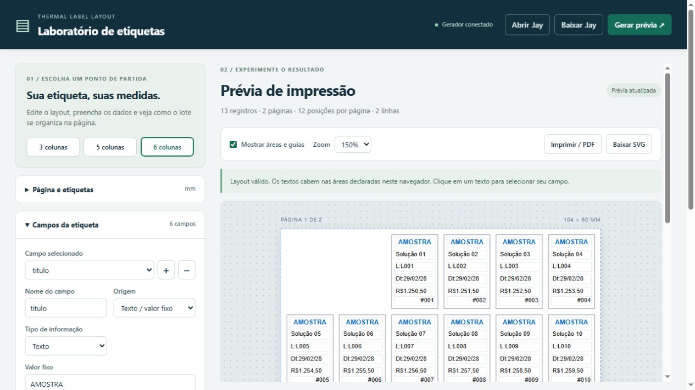

# TPrinter: tão antigo quanto funcional

Uma solução em Pascal para layouts de etiquetas, área imprimível, salto de colunas e prévia sem impressora.

Projeto completo e instruções para executar: [github.com/AdecioJunior/thermal-label-layout](https://github.com/AdecioJunior/thermal-label-layout).

Imprimir uma etiqueta parece simples até ser necessário trocar o tamanho do material, trabalhar com outra resolução ou distribuir o mesmo conteúdo em três, cinco ou seis colunas. Em etiquetas pequenas, alguns pontos de deslocamento já são suficientes para cortar uma informação ou comprometer sua leitura.

Esse problema aparece com frequência na impressão térmica hospitalar: identificação de amostras, tubos de ensaio, unitarização de medicamentos e etiquetas para ampolas. Há variedade de impressoras, drivers e apresentações de etiquetas. A aplicação precisa lidar com essa variação sem transformar cada novo formato em uma rotina de impressão diferente.

Há cerca de 15 anos, trabalhei nesse cenário criando classes que recebiam as dimensões da etiqueta, representavam os dados em objetos e centralizavam o cálculo da impressão. A experiência motivou este demonstrador independente, construído em Pascal para tornar a solução fácil de estudar e experimentar.

O ponto de partida continua sendo uma ferramenta conhecida de quem trabalha com Delphi: o `TPrinter`. Na VCL, ele oferece um Canvas para desenhar a página e métodos para controlar o documento. A aplicação descreve o desenho, e a saída passa pelo sistema de impressão do Windows e pelo driver instalado. Esse funcionamento está documentado pela [Embarcadero](https://docwiki.embarcadero.com/RADStudio/Athens/en/Printing_in_VCL_Applications).

Com essa abordagem, o código da aplicação pode trabalhar com texto, fontes e coordenadas, sem emitir comandos PPLA ou PPLB diretamente. A compatibilidade depende do driver, do suporte ao papel e da configuração do dispositivo. O `TPrinter` continua útil, mas precisa receber um desenho calculado corretamente.

Neste projeto, organizei esse trabalho em quatro responsabilidades: descrever o layout, resolver os dados, planejar a impressão e desenhar no destino.

O núcleo foi implementado em Object Pascal, usando Free Pascal e Lazarus. Ele utiliza records para representar configuração, campos, métricas e páginas planejadas, além de funções para validar, formatar e calcular. O desenho para Windows fica em um adaptador VCL separado. A mesma representação do plano também alimenta uma prévia SVG, permitindo testar a geometria sem impressora física.

**O layout começa em milímetros.** Largura, altura, margens, posição dos campos e intervalo entre etiquetas representam medidas físicas. A conversão para pixels acontece depois, usando a resolução de cada eixo do destino.

Para permitir alterações sem mexer no código, criei um arquivo `.lay`: um INI em UTF-8, com versão e regras de validação. A seção principal descreve a página e a grade; cada seção `field.nome` descreve um campo. Um exemplo de campo variável é:

```ini
[field.validade]
source=variable
type=date
bind=validade
mask=dd/mm/yy
prefix=Dt:
xMm=1
yMm=13
widthMm=auto
heightMm=3
fontSizePt=5.5
```

Esse campo procura a chave `validade` no registro, interpreta o valor como data e aplica a máscara antes do desenho. Com a entrada `2028-02-29`, o resultado é `Dt:29/02/28`.

Um campo fixo utiliza `source=fixed` e `value`, em vez de `bind`. Isso permite combinar, na mesma etiqueta, títulos fixos com identificação, lote, validade e outros dados variáveis. No demonstrador, `widthMm=auto` calcula o espaço restante até uma reserva de 1 mm na borda direita da etiqueta. Essa opção ajusta a área do campo; o tamanho da fonte continua explícito.

A leitura e a validação do `.lay` ficam em `labelLayout.pas`. Chaves desconhecidas, tipos não suportados e campos fora dos limites geram erro. O arquivo descreve dados e apresentação; ele não executa scripts.

**Tipos e máscaras são resolvidos antes da impressão.** Em `labelFormatting.pas`, cada campo tem um tratamento definido:

| Tipo | Entrada | Exemplo de apresentação |
| --- | --- | --- |
| Texto | `L001` | Máscara `L:{value}` produz `L:L001` |
| Data | `2028-02-29` | Máscara `dd/mm/yy` produz `29/02/28` |
| Decimal | `1250.50` | Máscara `#,##0.00` pode produzir `1.250,50` |
| Inteiro | `7` | Máscara `000` produz `007` |

Datas entram em um formato definido, com validação do calendário. Decimais usam ponto na entrada, sem separador de milhar. Na saída, os separadores são configurados explicitamente por meio de `TFormatSettings`, que reúne as opções utilizadas pelas rotinas de formatação da RTL. A estrutura está descrita na [documentação do Free Pascal](https://www.freepascal.org/docs-html/rtl/sysutils/tformatsettings.html).

Os valores decimais são tratados como `Currency`, limitando a entrada a quatro casas decimais. Uma máscara com menos casas pode arredondar a apresentação. Inteiros passam por `Int64`, preservando a precisão sem conversão intermediária para ponto flutuante.

Essa separação evita deixar o desenho responsável por interpretar datas, decidir separadores ou descobrir que um dado obrigatório está ausente.

**O salto de colunas é parte da geometria.** Uma apresentação com seis colunas não se resolve apenas repetindo a largura da etiqueta. É necessário considerar o intervalo entre colunas, a margem inicial e a mudança de linha.

O índice da posição na página determina coluna e linha com `mod` e `div`. No código do projeto, o cálculo é:

```pascal
indiceColuna := indiceNaPagina mod configuracao.quantidadeColunas;
indiceLinha := indiceNaPagina div configuracao.quantidadeColunas;

Result.esquerdaMm := configuracao.margemEsquerdaMm + indiceColuna *
  (configuracao.larguraEtiquetaMm + configuracao.espacoEntreColunasMm);

Result.topoMm := configuracao.margemSuperiorMm + indiceLinha *
  (configuracao.alturaEtiquetaMm + configuracao.espacoEntreLinhasMm);
```

O passo horizontal é a soma da largura da etiqueta com o intervalo até a próxima. Ao verificar se a grade cabe na página, uma linha com seis etiquetas possui cinco intervalos entre elas.

Um dos exemplos usa página de 104 × 60 mm, etiquetas de 15 × 24 mm, seis colunas, intervalos de 2 mm e margens de 2 mm. A largura necessária é `2 + (6 × 15) + (5 × 2) + 2 = 104 mm`. Na altura, cabem duas linhas, totalizando 12 posições por página.

A paginação usa a mesma lógica de índices. Se as duas primeiras posições já foram utilizadas, o lote começa na posição 2, considerando índices a partir de zero. Com 13 registros, dez etiquetas ocupam a primeira página e três seguem para a próxima. O salto afeta somente a primeira página.

**Área física e área imprimível precisam ser tratadas separadamente.** O tamanho do papel não garante que toda a superfície esteja disponível ao Canvas. No Windows, o driver informa dimensões físicas, região imprimível e deslocamentos entre essas origens. As diferenças entre `PHYSICALWIDTH`, `PHYSICALHEIGHT`, `HORZRES`, `VERTRES` e os offsets são descritas em [GetDeviceCaps, da Microsoft](https://learn.microsoft.com/en-us/windows/win32/api/wingdi/nf-wingdi-getdevicecaps).

O núcleo recebe essas informações em `TMetricasImpressao`. No modo de prévia, as métricas são simuladas. No adaptador VCL, são lidas do contexto da impressora.

A conversão básica permanece pequena:

```pascal
function milimetrosParaPixels(medidaMm: Double;
  resolucaoDpi: Integer): Integer;
begin
  Result := Round(medidaMm * resolucaoDpi / 25.4);
end;
```

Cada borda é convertida a partir de sua posição absoluta em milímetros. Isso evita acumular diferenças ao somar várias larguras já arredondadas. A resolução horizontal é utilizada nas coordenadas X; a vertical, nas coordenadas Y. O offset físico do driver é subtraído uma única vez para obter as coordenadas relativas à área imprimível.

Depois da conversão, o retângulo é validado contra os limites disponíveis. Nesse ponto, preferi funções com guard clauses e retorno no primeiro erro:

```pascal
function obterErroAreaImprimivel(const area: TAreaPixels;
  const metricas: TMetricasImpressao): string;
begin
  if area.esquerda < 0 then
    Exit('Area invade a margem fisica esquerda do dispositivo.');
  if area.topo < 0 then
    Exit('Area invade a margem fisica superior do dispositivo.');
  if area.direita > metricas.larguraImprimivelPixels then
    Exit('Area excede a largura imprimivel.');
  if area.base > metricas.alturaImprimivelPixels then
    Exit('Area excede a altura imprimivel.');
  if area.direita <= area.esquerda then
    Exit('Area nao tem largura em pixels.');
  if area.base <= area.topo then
    Exit('Area nao tem altura em pixels.');
  Result := '';
end;
```

Cada condição tem uma responsabilidade e uma mensagem. Nomes descritivos em camelCase ajudam a acompanhar o cálculo, enquanto os retornos antecipados mantêm o caminho válido fácil de localizar.

Neste demonstrador, a etiqueta inteira precisa caber na área imprimível. O código também verifica se o tamanho físico fornecido pelo driver corresponde ao layout. A configuração do papel continua explícita no dispositivo: o projeto não altera automaticamente o formulário ou a orientação do driver.

**O resultado dos cálculos é um plano de impressão.** Em `labelPlan.pas`, cada página recebe suas etiquetas; cada etiqueta contém os textos já formatados e os retângulos de seus campos. Todo o lote é resolvido antes de começar a renderização.

Se uma data do último registro for inválida, o problema aparece nessa preparação. A mensagem identifica registro e campo. Essa validação antecipada não transforma a impressão em uma transação: ainda podem ocorrer falhas de disco, driver ou dispositivo durante a saída.

O adaptador VCL recebe o plano, mede os textos no Canvas de destino e controla o documento com `BeginDoc`, `NewPage`, `EndDoc` e `Abort`. Essa organização permite manter a regra de posicionamento fora do ciclo de impressão.

Também há uma distinção importante entre o retângulo caber na página e o texto caber no retângulo. Uma fonte pode ultrapassar a largura declarada, e fontes disponíveis em diferentes destinos podem ter métricas diferentes. Em etiquetas pequenas, isso precisa ser verificado antes de confiar no resultado.

**Para experimentar a solução, construí um laboratório de layouts.** O painel HTML permite alterar dimensões, margens, colunas, campos, máscaras e dados de teste. Um botão gera a prévia; outro permite baixar o `.lay`. Também é possível importar um arquivo existente.



O servidor local foi implementado em Pascal com `TFPHTTPServer`. O navegador envia o layout e os dados, e o servidor executa as mesmas funções utilizadas pela versão por linha de comando. O SVG retornado é desenhado a partir do mesmo plano de impressão.

O JavaScript cuida da edição e da visualização. Ele também mede os textos com as fontes disponíveis no navegador, destaca os que excedem os campos e bloqueia o botão de impressão nesses casos. A geometria e a formatação dos valores permanecem no Pascal.

Essa estrutura permitiu testar o comportamento sem uma impressora ao lado. O núcleo passou por 64 verificações, incluindo grades, paginação, posições já utilizadas, DPI diferente por eixo, offsets físicos, datas e precisão numérica. Outras 34 verificações de integração exercitam o servidor, as entradas inválidas, UTF-8 e a igualdade dos SVGs gerados pelo painel e pela CLI.

O projeto foi compilado com Free Pascal e `lazbuild` para Windows de 32 e 64 bits. O adaptador VCL com `TPrinter` está disponível como código-fonte, mas ainda precisa ser compilado no Delphi e validado em impressora física. A prévia não confirma calibração, avanço do material ou legibilidade no papel. A versão atual trabalha com texto em uma linha, sem códigos de barras, imagens ou ajuste automático de fonte.

A contribuição central desta implementação está em dar uma representação comum ao problema: dimensões físicas, campos tipados, regras de formatação e um plano de páginas. Com isso, um novo tamanho de etiqueta pode ser descrito por configuração, desde que seus campos continuem cabendo e permaneçam legíveis.

O `TPrinter` permanece uma opção funcional para a etapa de saída no Windows. Ao redor dele, conseguimos organizar código legível, validação antecipada e uma forma prática de experimentar a solução. O projeto completo está no meu portfólio no GitHub, com os fontes em Pascal, os layouts de exemplo, o painel e as instruções de execução: [AdecioJunior/thermal-label-layout](https://github.com/AdecioJunior/thermal-label-layout).
